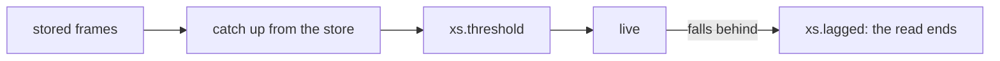

When a reader falls behind the live stream:

| reader | before | 0.15.0 |
|---|---|---|
| any follower: `xs cat -f`, `.cat -f`, HTTP with follow, `Store::read` | the read ended with no error, as if it were done | the read ends with `xs.lagged` |
| an actor | stopped getting frames and said nothing (#169) | stops with `.fin.error` |
| the actor, service and action supervisors | stopped without a word, until xs restarted | read what they missed from the store, and carry on |



## Breaking: `Store::read` yields `Result<Frame, ReadError>` (#170)

For code that embeds xs:

```diff
-while let Some(frame) = rx.recv().await {
+while let Some(item) = rx.recv().await {
+    let frame = item?; // Err(ReadError::Lagged { skipped }) when it fell behind
```

Design: [ADR 0008](https://github.com/cablehead/xs/blob/main/docs/adr/0008-follow-scan-first.md), and for the supervisors (#172), [ADR 0009](https://github.com/cablehead/xs/blob/main/docs/adr/0009-supervisors-catch-up.md).

## An actor's step is written all at once (#168)

| an actor's step: its appends and its `.out` | before | 0.15.0 |
|---|---|---|
| written | one frame at a time | one batch (`Store::append_many`) |
| another writer's frames | could land between them | cannot |
| a failed write | dropped silently | writes nothing |

## `xs cat` into a file (#173)

```
$ xs cat > frames.jsonl     # before: Operation not permitted (macOS: Invalid argument)
$ xs cat > /dev/null        # both work now
```

## Changelog

- test: the watch test fails at once with the service's error, and names inotify exhaustion as an environment limit (#175)
- test: fix clippy warnings in the integration tests (#174)
- fix: xs cat writes to a regular file or /dev/null (#173)
- fix: a supervisor that falls behind live reads what it missed from the store (#172)
- refactor: use xs::Error for the crate's boxed error, not written out or private aliases (#171)
- fix: read stored frames before subscribing, end a live lag with xs.lagged (ADR 0008) (#170)
- docs: note that actor appends land when the closure returns (#167)
- feat: write an actor's appends and out frame as one batch (#168)
