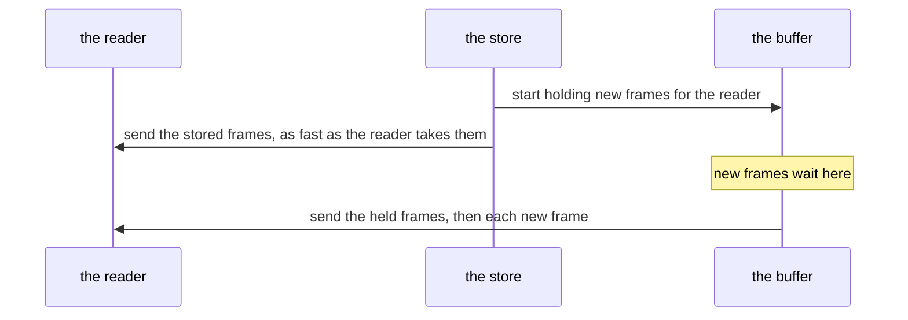
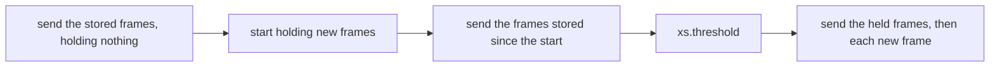

# 0008: Follow: scan first, subscribe after, error on a live lag

When something follows the stream (`xs cat -f`, an actor, a service, a supervisor), the store sends it every frame already stored, then each new frame as it is appended.

## How it works today



The store starts holding new frames before it sends the stored ones, so nothing appended in between is missed. The buffer holds at most 4096 frames. When more than that wait, the store ends the read and closes it, without an error.

## The problem

Anything an actor appends while it is still working through the stored frames is held in its buffer, waiting for it to finish reading them.

| reader | what it appends while reading stored frames | on a store of 5,000 frames |
|---|---|---|
| an actor with `start: "first"` that writes a frame for every frame it reads | as many frames as are stored | the buffer overruns every time it starts |
| an actor that writes rarely | a few | fine, unless a burst of appends arrives while it reads slowly |

When the buffer overruns, the actor stops getting frames and says nothing: no `fin.error`, its thread idle, new frames still landing. Seen in production on xs 0.14.1 ([#169](https://github.com/cablehead/xs/pull/169)).

## Decision

### Read the stored frames before holding new ones



| | today | with this |
|---|---|---|
| frames held while the reader works through the stored frames | everything appended meanwhile, up to 4096 | none |
| frames appended meanwhile | in the buffer, which can overrun | read from the store afterwards |
| what the buffer has to cover | the whole time spent on the stored frames | only the catch-up afterwards |
| extra work for a reader that appends nothing | none | another look at the store, which finds nothing |

The order and the skipping of repeats work as today: stored frames, then `xs.threshold`, then new ones, and a new frame already sent in the catch-up is skipped.

### Falling behind while live is an error

Once the reader is past the stored frames, letting 4096 new frames pile up means it is slower than the stream. The store then ends its read with a last frame that says so, instead of closing it silently:

```
topic: xs.lagged
meta:  {skipped: 506}
```

An actor or service turns that into its usual error. There is no retry and no setting: the buffer only has to cover the catch-up, which is short unless more than 4096 frames arrive while it runs. An actor reading back its own output writes nothing for it, so for actors this only happens to a reader that cannot keep up with the live stream, and a retry would not help. A store shutting down still ends the read as today.

## Considered

| approach | why not |
|---|---|
| the actor reopens its read when it ends ([#169](https://github.com/cablehead/xs/pull/169)) | fixes actors only, while services and supervisors follow the same way; and it cannot tell an overrun from the store shutting down, so on shutdown it reopens over and over |
| on an overrun, read the missed frames from the store, then hold new frames again | an actor that writes a frame for every frame it reads overruns again and again: about once per 4096 stored frames, so about 100 times on a store of 400,000 |
| a setting for how many retries | the number needed grows with the store, which no operator can know; and once reading stored frames cannot overrun, only live overruns remain, where a retry does not help |

## Consequences

- The actor no longer needs #169's reopening. Its test (an actor reading `FOLLOW_BUFFER + 500` stored frames, then counting a new frame exactly once) carries over as a case that must pass.
- Every reader that follows the stream gets the change: actors, services, supervisors, `xs cat -f`.
- `xs.lagged` is a new frame: a reader that cares can watch for it.
