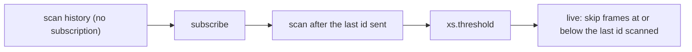

# 0008: Follow: scan first, subscribe after, error on a live lag

A following read (`follow` on) replays history and then delivers live frames. Today `Store::read` takes its broadcast subscription before the historical scan, so nothing appended during the scan is missed, and drains it only once the scan is done. The subscription holds at most `FOLLOW_BUFFER` (4096) frames. If more arrive before the reader drains them, the follow task gets `Lagged` and ends the read by closing the channel.

## The problem

The reader paces the scan: the scan thread blocks on `blocking_send` until the reader takes each frame. So everything appended while a slow reader replays piles up in its subscription.

An actor with `start: "first"` that writes a frame per frame it replays writes as many frames as there are in history. On any store past 4096 frames, its own output overruns its own subscription on its first start, every time. Its read ends; the actor loop takes the closed channel as the end and goes quiet: no `fin.error`, the thread idle, appends still landing. Seen in production on xs 0.14.1 ([#169](https://github.com/cablehead/xs/pull/169)).

For actors that write rarely, the same lag is a rare footgun: a slow closure or a burst of appends freezes the actor with no word.

## Decision

### Scan first, subscribe after

A following read scans history with no subscription, then subscribes, then scans again from the last id it sent, then goes live:

- No subscription is held while a slow reader replays, so nothing piles up during the replay. Frames appended meanwhile, the reader's own output included, are read from the store in the second scan.
- The second scan only has to be covered by the subscription for what arrives while it runs. For an actor reading back its own output, that is nothing: it writes nothing for its own frames.
- Order and dedupe hold as today: history, then `xs.threshold`, then live, with live frames at or below the last scanned id skipped.
- The normal case costs one extra scan, which finds nothing when nothing was appended during the first.

### A lag while live is an error

If a read lags while live, it is the reader that cannot keep up with the live stream. The store ends the read with an error the reader can see, rather than closing the channel silently: a final `xs.lagged` frame carrying how many frames it skipped, then the close. An actor or service turns that into its usual error.

No retries and no option: a lag on start is not possible with scan-first, so a lag means the reader is slower than the live stream, and retrying cannot help. `Closed` (the store shutting down) still ends the read as today.

## Considered

| approach | why not |
|---|---|
| Resume in the actor after the read ends ([#169](https://github.com/cablehead/xs/pull/169)) | fixes actors only; services and supervisors follow the same way. It also cannot tell a lag from the store closing, so on shutdown it reopens in a loop. |
| On a lag, rescan from the last id sent, then subscribe again | a per-frame writer on a large store lags again and again: about one catch-up per 4096 frames of history (100 for a 400,000-frame store) |
| A catch-up count as a read option | the count needed grows with the store, which no operator can set sensibly; with scan-first, only live lags remain, where a retry cannot help |

## Consequences

- #169's resume logic in the actor is not needed. Its test, an actor replaying `FOLLOW_BUFFER + 500` frames and then counting one live frame once, carries over as the case that must pass.
- Every following reader gets the change: actors, services, supervisors and `xs cat -f`.
- `xs.lagged` is new: readers that care can watch for it; the processors turn it into their usual error.
