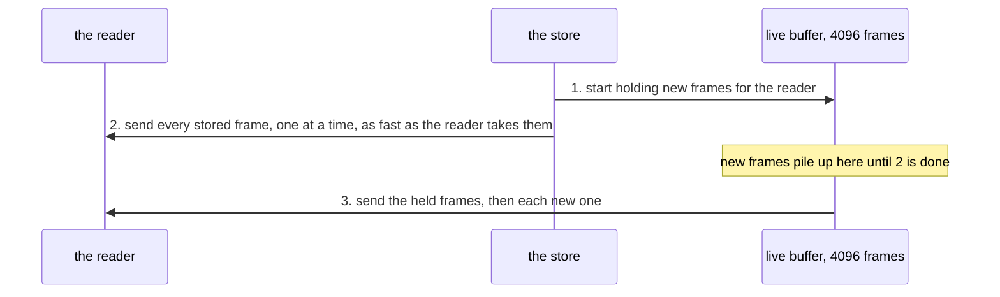
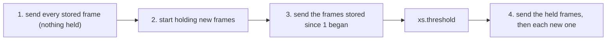

# 0008: Follow: scan first, subscribe after, error on a live lag

A reader that follows the stream (`xs cat -f`, every actor, service and supervisor) gets two things on one channel: first every frame already stored, then each new frame as it is appended.

## How it works today



Step 1 comes first so that nothing appended during step 2 is missed. The buffer holds at most 4096 frames. If more pile up, the store ends the read and closes the channel, with no error.

## The problem

Anything an actor appends while it is still working through the stored frames is held in its buffer, waiting for it to finish reading them.

| reader | frames it appends during step 2 | on a store of 5,000 frames |
|---|---|---|
| an actor with `start: "first"` that writes one frame per frame it reads | as many as there are stored | the buffer overruns on every first start |
| an actor that writes rarely | a few | fine, unless a burst of appends arrives during a slow step 2 |

When the buffer overruns, the actor stops getting frames and says nothing: no `fin.error`, its thread idle, new frames still landing. Seen in production on xs 0.14.1 ([#169](https://github.com/cablehead/xs/pull/169)).

## Decision

### 1. Read the stored frames first, then start holding new ones



| | today | with this |
|---|---|---|
| frames held while the reader replays history | everything appended meanwhile, up to 4096 | none |
| frames appended during the replay | in the buffer, can overrun it | read from the store in step 3 |
| what the buffer has to cover | the whole replay | only step 3 |
| extra work for a reader that writes nothing | none | one more look at the store, which finds nothing |

Order and duplicates are handled as today: stored frames, then `xs.threshold`, then live, and a live frame already sent in step 3 is skipped.

### 2. Falling behind while live is an error

After step 4, a reader that lets 4096 new frames pile up is slower than the stream itself. The store ends its read with a last frame saying so, instead of closing silently:

```
topic: xs.lagged
meta:  {skipped: 506}
```

then closes. An actor or service turns that into its usual error. There is no retry and no setting: with step 1, this cannot happen while replaying, so it only happens to a reader that cannot keep up, and retrying would not help. A store shutting down still ends the read as today.

## Considered

| approach | why not |
|---|---|
| the actor reopens its read when it ends ([#169](https://github.com/cablehead/xs/pull/169)) | fixes actors only; services and supervisors follow the same way. It cannot tell an overrun from the store shutting down, so on shutdown it reopens in a loop |
| on an overrun, read the missed frames from the store, then hold new ones again | an actor that writes one frame per frame overruns again and again: about one retry per 4096 stored frames (100 for a store of 400,000) |
| a setting for how many retries | the number needed grows with the store, so no operator can set it; with step 1, only live overruns remain, where a retry cannot help |

## Consequences

- The actor no longer needs #169's reopening. Its test (an actor reading `FOLLOW_BUFFER + 500` stored frames, then counting one new frame exactly once) carries over as a case that must pass.
- Every following reader gets the change: actors, services, supervisors, `xs cat -f`.
- `xs.lagged` is a new frame: readers that care can watch for it.
